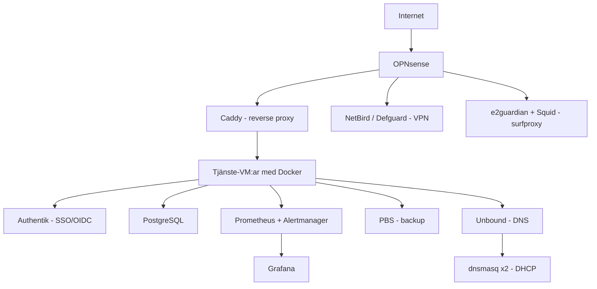

# Mjukvaruplan för serverhallen

Förutsättningar: Proxmox VE som virtualiseringsgrund, PBS för backup, i princip allt i Docker-containrar, 50–200 användare, open source (betalversion av open source tillåten).

## Arkitekturbeslut: Docker Compose i stället för Kubernetes (ADR 001)

**Status**: Beslutat. **Datum**: 2026-11-15

**Kontext**: All mjukvara planeras köras i containers. Alternativen var Docker Compose (bekant från Podman-compose), K3s (Rancher) för småkluster och RKE2 för större/reglerade miljöer. Verksamheten är på 50–200 användare och ofta en enda nod.

**Beslut**: Docker Compose per Docker-värd, orkestrerat med Ansible och uppdaterat via Renovate.

**Motivering**:

- Med en nod ger Kubernetes self-healing/HA ingen verklig vinst – ligger noden är allt nere oavsett orkestrerare.
- Lägre driftkostnad: ingen control plane, ingen klusterdatabas, inga klusteruppgraderingar.
- Enklare felsökning (`docker logs`) och enklare stateful-tjänster (Stalwart, PostgreSQL, Nextcloud, PBS).
- Samma GitOps-fördelar nås med Ansible + Renovate mot compose-filer.
- Teamets befintliga kompetens är compose; K8s-inlärningskurvan ger ingen avkastning idag.

**Konsekvenser**:

- Utvärdera K3s igen vid 3+ noder, behov av HA eller rullande uppdateringar/GitOps i skala.
- RKE2 är relevant först vid regelverk/HA-kluster.

## Arkitekturöversikt

## Tjänstelista

| Område                   | Val                                     | Noteringar                                                                                                              |
| ------------------------ | --------------------------------------- | ----------------------------------------------------------------------------------------------------------------------- |
| Virtualisering           | Proxmox VE                              | Dedikerad Docker-värd-VM (eller två för HA) i stället för containers direkt på hypervisorn                              |
| Backup                   | Proxmox Backup Server                   | Offsite-kopia krävs (3-2-1)                                                                                             |
| Brandvägg                | OPNsense                                | Kör som VM med PCI-passthrough av två NIC; alternativt dedikerad hårdvara                                               |
| Reverse proxy            | Caddy                                   | Automatisk Let's Encrypt, proxy mot alla publika tjänster                                                               |
| Webserver                | Caddy + PHP-FPM                         | Caddy klarar PHP via `php_fastcgi`; JS är statiskt. Kör PHP-FPM som container                                           |
| VPN                      | Headscale                               | Stödjer OIDC mot Authentik.                                                                                             |
| Surfproxy                | e2guardian → Squid                      | e2guardian som filter framför Squid som cache; policy för vilka nät som tvingas genom proxyn                            |
| DNS                      | Unbound                                 | Rekursiv resolver + lokal zonfil. Kör i container eller på OPNsense                                                     |
| DHCP                     | dnsmasq ×2                              | Primär + sekundär med fördröjd svarstid (`dhcp-reply-delay`). Låt Unbound sköta DNS så dnsmasq bara gör DHCP            |
| Mätvärden                | Prometheus                              | Med exporters (node\_exporter, cAdvisor, blackbox)                                                                      |
| Visualisering/alertering | Grafana + Alertmanager                  | Grafana är bara visualisering – larmlogiken ligger i Alertmanager (eller Grafana Alerting). Notifiering via mail/Slack  |
| Loggar                   | Loki                                    | Central loggning från containrar och OPNsense                                                                           |
| Logg-/metrikagenter      | Grafana Alloy                           | En per server – skickar loggar till Loki och kan vidarebefordra metrik                                                  |
| Värdmetrik               | Node Exporter                           | En per Linux-värd                                                                                                       |
| Containermetrik          | cAdvisor                                | En per Docker-värd                                                                                                      |
| Uptime                   | Uptime Kuma (tillägg)                   | Enkel extern-vy av tjänstehälsa                                                                                         |
| Identitet/SSO            | Authentik                               | OIDC/SAML till Nextcloud, Grafana, Forgejo, Zammad, OpenProject, Vaultwarden, VPN. Användardata i PostgreSQL eller LDAP |
| Lösenord                 | Vaultwarden                             | Per användare                                                                                                           |
| Hemligheter (Ansible)    | Ansible Vault + Vaultwarden             | Vault-filer krypterade i Git; vault-lösenordet sparas i Vaultwarden. Vault-id per miljö                                 |
| Mail                     | Stalwart                                | SMTP/IMAP/JMAP + Rspamd + ClamAV                                                                                        |
| Filer                    | Nextcloud                               | Ev. Nextcloud Talk för intern chatt                                                                                     |
| Video                    | Jitsi                                   | RTMP/Livestream för större möten                                                                                        |
| Git                      | Forgejo                                 | Med pull-mirrors tillåtna utåt                                                                                          |
| Image-repo               | Harbor                                  | Proxy-cache-projekt endast mot godkända registries; Trivy-scanning inbyggd                                              |
| apt-cache                | apt-cacher-ng                           | Endast `Remap`-definierade repon, tom `PassThroughPattern`                                                              |
| dnf-cache                | nginx proxy\_cache                      | En `location` per godkänt repo, default 403, fasta `baseurl`                                                            |
| Go-moduler               | Athens                                  | Filterfil `+`/`-`/`D`, proxia även sum.golang.org                                                                       |
| PyPI                     | devpi eller proxpi                      | Svagaste länken: devpi kan låsa mirror-innehåll via indexpolicy; komplettera med allowlist i nginx framför              |
| Git-cache                | Forgejo mirrors / git-cache-http-server | Allowlist på värd/sökväg i nginx framför cachen                                                                         |
| Antivirus/antispam       | ClamAV + Rspamd                         | Rspamd kopplas till Stalwart                                                                                            |
| Databas                  | PostgreSQL                              | Delad instans eller en per tung tjänst (Zammad, OpenProject, XWiki, Nextcloud)                                          |
| Wiki (org)               | XWiki                                   | Java/Tomcat + PostgreSQL – tyngre container, reservera resurser                                                         |
| Wiki (projekt)           | OpenProject inbyggda wiki               | Undvik dubletter: riksnivå i XWiki, projektlevel i OpenProject                                                          |
| Ärenden                  | Zammad                                  | Kräver Elasticsearch + PostgreSQL                                                                                       |
| Projekt/kund             | OpenProject                             | Gantt, tidrapportering, agila boardar                                                                                   |
| Foton                    | PhotoPrism                              |                                                                                                                         |
| Certifikat               | Let's Encrypt                           | Externa tjänster via HTTP-01; interna via DNS-01, båda förnyas automatiskt av Caddy                                     |
| Konfig/patch             | Ansible + Renovate                      | Renovate mot Forgejo för image-bumpar; Ansible-hemligheter via Vault, vault-lösenord i Vaultwarden                      |
| Verktygsserver           | Egen VM/container-värd                  | Ansible, rapportskript via Python-image, cron                                                                           |
| Uptime                   | Uptime Kuma (tillägg)                   | Enkel extern-vy av tjänstehälsa                                                                                         |

## Driftstack: placering

| Komponent     | Antal             | Placering                                         |
| ------------- | ----------------- | ------------------------------------------------- |
| Grafana       | 1                 | Central server                                    |
| Loki          | 1                 | Central server                                    |
| Prometheus    | 1                 | Central server                                    |
| Alertmanager  | 1                 | Central server (eller Grafanas inbyggda alerting) |
| Grafana Alloy | 1 per server      | Alla servrar                                      |
| Node Exporter | 1 per Linux-värd  | Alla Linux-servrar                                |
| cAdvisor      | 1 per Docker-värd | Docker-servrar                                    |

## Kvarvarande luckor att besluta

1. **Offsite-backup** – var tar PBS-replikan vägen (annan plats, krypterad)?
2. **Nätsegmentering** – hantering/servrar/användare/gäster, VLAN-plan.
3. **Chatt** – Nextcloud Talk räcker, eller Rocketchat/Mattermost om ni vill ha riktig kanalstruktur?
4. **Testmiljö** – minst en fristående Docker-värd för staging innan produktion.

## Föreslagen installationsordning

1. **Grund**: Proxmox, OPNsense, VLAN, Unbound, dnsmasq ×2
2. **Säkerhet**: PBS + offsite, Authentik, Vaultwarden, Caddy, VPN
3. **Kärntjänster**: Stalwart + Rspamd/ClamAV, Nextcloud, PostgreSQL
4. **Utveckling**: Forgejo, Harbor + caches (apt/dnf/Go/PyPI/Git), tools-server, Ansible + Renovate
5. **Verksamhet**: OpenProject, XWiki, Zammad, Jitsi, PhotoPrism
6. **Drift**: Prometheus, Alertmanager, Grafana, Loki, Uptime Kuma